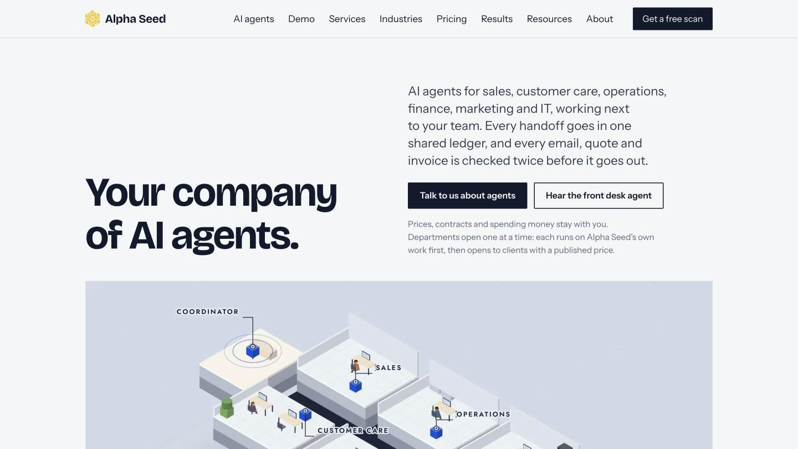

# Alpha Seed — company website

**Live site:** [alphaseed.ca](https://alphaseed.ca) 
**Company:** Alpha Seed Inc., Calgary — AI agents, marketing and IT for local businesses 
**My role (part-time):** design and build, DNS and SSL, search setup, ongoing updates

> The source code is private. This repo shows what the site does and how I built it.

## What the site does

- Multi-page site: AI agents, Demo, Services, Industries, Pricing, Results, Resources and About.
- A "Get a free scan" request form and a demo page.

## How I built it

1. **Design and build:** HTML and CSS with AI-assisted development (Claude); responsive layout for phones and desktops.
2. **DNS and SSL:** set up DNS and serve the site over HTTPS through Cloudflare.
3. **Search and Google:** page titles and descriptions, `Organization`, `ProfessionalService`, `WebSite` and `VideoObject` structured data (schema.org), and the Google Business Profile.
4. **Ongoing:** keep pages and content up to date.

## Tools

HTML · CSS · Cloudflare · schema.org
